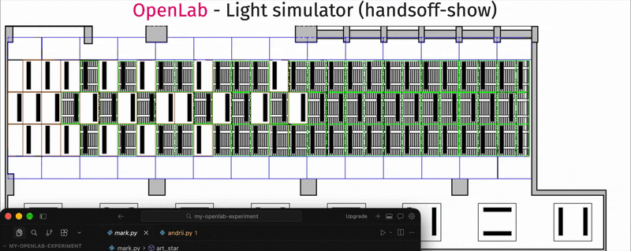

# OpenLab Light Show — TUKE Hands-Off

Controlling the lights and screens of [OpenLab](https://kpi.fei.tuke.sk/openlab) at FEI TUKE
through the [`tuke-openlab`](https://git.kpi.fei.tuke.sk/open-lab/tuke-openlab-sdk) SDK.



## Authors

| Name | GitHub |
| --- | --- |
| Mark | [@MisterMog25](https://github.com/MisterMog25) |
| Andrii | [@AndrewPryladyshev](https://github.com/AndrewPryladyshev) |
| Tymofei | _GitHub handle to be added_ |

## Requirements

- [`uv`](https://docs.astral.sh/uv/getting-started/installation/) — installs Python and the dependencies
- Access to the OpenLab MQTT broker: **TUKE VPN** is needed outside the university network
  ([Check Point VPN](https://uvt.tuke.sk/sk/vzdialeny-pristup-cez-vpn), server `remote.tuke.sk`)

`uv` downloads the right Python and puts everything into `.venv/`. No manual Python install,
no manual `pip`, no need to activate the virtual environment.

## Getting started

```bash
git clone https://github.com/MisterMog25/my-openlab-experiment.git
cd my-openlab-experiment
uv sync          # creates .venv/ from uv.lock — the same versions for everyone
uv run main.py   # runs the whole show (~90 s) against the simulator
```

Ready-made SDK examples (flags, pulse, spectrum, interpolation helpers) are in
`~/Documents/openlab/tuke-openlab-sdk/examples/` or
[on GitLab](https://git.kpi.fei.tuke.sk/open-lab/tuke-openlab-sdk/-/tree/master/examples).

## Project structure

One file per person. Everybody writes their own scene in their own file:

```
.
├── main.py       # the show: runs the three scenes in a row, in one process
├── mark.py       # Mark's scene
├── andrii.py     # Andrii's scene
├── tymofii.py    # Tymofii's scene
├── helpers.py    # ready-made building blocks and effects — import them in your file
├── docs/show.gif # demo recording
├── pyproject.toml / uv.lock   # dependencies (commit uv.lock)
└── README.md
```

```bash
uv run main.py          # the full show: Mark -> Andrii -> Tymofii
uv run main.py --lab    # the same, on the real lamps
uv run mark.py          # or run your own file alone
```

> `main.py` connects **once** and calls every author's `show(lights)` in order, so the scenes
> share one MQTT connection and one topic (`handsoff-show`). Every author also keeps a
> `show(lights)` entry point, so a scene can be run alone with `uv run <name>.py`.

## Which environment and which topic

```python
import tuke_openlab

openlab = tuke_openlab.Controller(tuke_openlab.simulation_env("your-topic"))  # simulator
openlab = tuke_openlab.Controller(tuke_openlab.production_env())              # REAL lamps
```

The **same code** drives both — only the topic differs. The simulator is a web page that
subscribes to the same MQTT topic, so you see exactly what the lamps would show:

```
https://openlab.kpi.fei.tuke.sk/simulator/light/<your-topic>
```

> ⚠️ **Every person must use their own topic.** Each file already has its own one
> (`mark`, `andrii`, `tymofii`). Keep it unique — the topic namespace is shared with every
> other student in the lab, so a very generic name can collide. Prefixing with the course,
> e.g. `handsoff-mark`, is safer. Topics must not contain MQTT wildcards (`+`, `#`)
> or null characters.

Only use `production_env()` when the lab is free. One laptop, one process — two scripts
publishing to the same topic overwrite each other.

## What you can control

Everything hangs off the `Controller` object returned above:

| Attribute | What it does |
| --- | --- |
| `openlab.lights` | colors of the 97 lamps (`set_all`, `set_colors`, `set_color`, `turn_on`, `turn_off`) |
| `openlab.screens` | content of the displays (`panel_2x2`, `vertical[1..5]`) |
| `openlab.voice_recognition` | react to spoken words (`on_recognized`) |
| `openlab.movement_tracker`, `openlab.kinect` | react to movement (`on_movement`) |

The lights grid: **3 rows × 27 columns = ids 1–81** (column 1 is the rightmost one),
plus **8 windows × 2 lamps = ids 82–97**.

Ready-made effects and grid helpers live in `helpers.py` (ported from the SDK examples):

```python
from helpers import column, row, windows, mix, hsv          # grid and colors
from helpers import flag, pulse, rainbow, spectrum, random_colors   # effects

pulse(lights, seconds=15)      # every effect blocks for `seconds`, so they can be chained
```

```python
from tuke_openlab.lights import Color

lights.set_all(Color(r=255), fade=1000)          # all lamps red, 1 s fade
lights.set_colors({1: Color(r=255), 28: Color(b=255)}, fade=500)
lights.turn_off()
```

## Useful commands

```bash
uv run main.py            # the full show (simulator, topic handsoff-show)
uv run main.py --lab      # the full show (real lamps)
uv run mark.py            # run one author's file alone
uv add <package>          # add a dependency (updates pyproject.toml and uv.lock)
uv sync                   # reinstall the environment from uv.lock
```

## Contributing

Dependencies are added through `uv add`, which edits `pyproject.toml` and `uv.lock`. Two people
editing them at the same time means a Git conflict, so **do not add dependencies in parallel** —
one person adds, everyone else runs `uv sync`.

We push directly to `main` (no pull requests), which means one rule before every push:

```bash
git pull --rebase          # always, otherwise the push is rejected
git add mark.py            # only your own file
git commit -m "feat: my scene"
git push origin main
```

## Resources

- [Hands-Off: controlling the lights](https://pages.kpi.fei.tuke.sk/kpi/hands-off/02/) — the assignment
- [Lights API](https://pages.kpi.fei.tuke.sk/kpi/hands-off/02/api.html) — services, colors, examples
- [tuke-openlab SDK](https://git.kpi.fei.tuke.sk/open-lab/tuke-openlab-sdk) — source, `docs/`, `examples/`
- [OpenLab platform](https://kpi.fei.tuke.sk/openlab)
