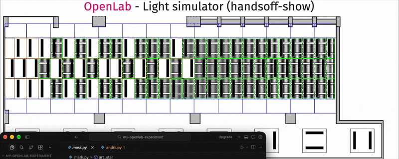

# OpenLab Light Show — TUKE Hands-Off

A 90-second light show on the 97 lamps and 8 windows of
[OpenLab](https://kpi.fei.tuke.sk/openlab) at FEI TUKE, driven by Python through the
[`tuke-openlab`](https://git.kpi.fei.tuke.sk/open-lab/tuke-openlab-sdk) SDK.

Course: *Hands-Off — Distributed architectures*, 2026/2027.



## The show

One process connects once and plays three scenes in a row, then exits:

| Order | Author | Scene | Length |
| --- | --- | --- | --- |
| 1 | Mark | A heat-map "star" ignites in the centre and floods the whole grid, cools down and fades to black; then a coloured sine wave runs across the grid and is swallowed back into the centre | ~50 s |
| 2 | Andrii | A rainbow sweeps the grid, then ripples expand from random points | ~23 s |
| 3 | Tymofii | Two smooth cyan/magenta sine waves — parallel lines first, then a travelling wave | ~20 s |

Total ≈ 90 s. The script stops on its own when the show ends; `Ctrl+C` stops it early.

You can watch the lamps live on the simulator page — the same MQTT topic the show publishes to:

```
https://openlab.kpi.fei.tuke.sk/simulator/light/handsoff-show
```

## Authors

| Name | GitHub |
| --- | --- |
| Mark | [@MisterMog25](https://github.com/MisterMog25) |
| Andrii | [@AndrewPryladyshev](https://github.com/AndrewPryladyshev) |
| Tymofei | [@n0stylist](https://github.com/n0stylist) |

## Requirements

- [`uv`](https://docs.astral.sh/uv/getting-started/installation/) — installs Python 3.14 and the
  dependencies for you (no manual Python install, no `pip`, no need to activate anything)
- Access to the OpenLab MQTT broker. Inside the university network it just works; from outside,
  connect the **TUKE VPN** first
  ([Check Point VPN](https://uvt.tuke.sk/sk/vzdialeny-pristup-cez-vpn), server `remote.tuke.sk`)

## Getting started

```bash
git clone https://github.com/MisterMog25/my-openlab-experiment.git
cd my-openlab-experiment
uv sync          # creates .venv/ from uv.lock — the same versions for everyone
uv run main.py   # plays the whole show (~90 s) on the simulator
```

To play it on the real lamps instead of the simulator:

```bash
uv run main.py --lab
```

The SDK is installed from TUKE's package index, already configured in `pyproject.toml`
(`[[tool.uv.index]]`), so `uv sync` needs no extra flags.

## Project structure

```
.
├── main.py       # the show: connects once and runs the three scenes in order
├── mark.py       # scene 1
├── andrii.py     # scene 2
├── tymofii.py    # scene 3
├── helpers.py    # grid helpers + ready-made effects (ported from the SDK examples)
├── docs/show.gif # demo recording (show sped up 3x)
├── pyproject.toml / uv.lock
└── README.md
```

Each author's file also runs on its own (`uv run mark.py`, `uv run andrii.py`,
`uv run tymofii.py`) — those connect to the simulator on their own topic, so a single scene can be
replayed without the rest of the show.

## How it works

The script publishes JSON colour commands over **MQTT** to `openlab.kpi.fei.tuke.sk`; the broker
fans them out to 10 Raspberry Pis, each of which switches its own lamps. That is the *distributed
architecture* part of the assignment: we only send messages, the devices do the work.

```python
import tuke_openlab

openlab = tuke_openlab.Controller(tuke_openlab.simulation_env("handsoff-show"))  # simulator
openlab = tuke_openlab.Controller(tuke_openlab.production_env())                 # REAL lamps
```

The **same code** drives both — only the topic differs. The simulator is a web page subscribed to
the same topic, so you see exactly what the lamps would show:

```
https://openlab.kpi.fei.tuke.sk/simulator/light/<topic>
```

Topic names must not contain MQTT wildcards (`+`, `#`) or null characters. The topic namespace is
shared with every other student in the lab, so keep the name specific — that is why the show uses
`handsoff-show` and not something generic like `test`.

> ⚠️ One laptop, one process. Two scripts publishing to the same topic overwrite each other's
> frames. Only use `production_env()` when the lab is free.

## What you can control

| Attribute | What it does |
| --- | --- |
| `openlab.lights` | colours of the 97 lamps (`set_all`, `set_colors`, `set_color`, `turn_on`, `turn_off`) |
| `openlab.screens` | content of the displays (`panel_2x2`, `vertical[1..5]`) |
| `openlab.voice_recognition` | react to spoken words (`on_recognized`) |
| `openlab.movement_tracker`, `openlab.kinect` | react to movement (`on_movement`) |

The lights grid: **3 rows × 27 columns = ids 1–81** (column 1 is the rightmost one),
plus **8 windows × 2 lamps = ids 82–97**.

```python
from helpers import column, row, windows, mix, hsv                     # grid and colours
from helpers import flag, pulse, rainbow, spectrum, random_colors      # effects

pulse(lights, seconds=15)      # every effect blocks for `seconds`, so they can be chained
```

```python
from tuke_openlab.lights import Color

lights.set_all(Color(r=255), fade=1000)          # all lamps red, 1 s fade
lights.set_colors({1: Color(r=255), 28: Color(b=255)}, fade=500)
lights.turn_off()
```

## Useful commands

```bash
uv run main.py            # the full show (simulator, topic handsoff-show)
uv run main.py --lab      # the full show (real lamps)
uv run mark.py            # run one scene alone
uv add <package>          # add a dependency (updates pyproject.toml and uv.lock)
uv sync                   # reinstall the environment from uv.lock
```

## Troubleshooting

| Symptom | Cause / fix |
| --- | --- |
| `command not found: uv` | Install uv (link above), then reopen the terminal. |
| Connection error / timeout on start | Not on the university network and no VPN. Connect the TUKE VPN. To test the broker: `nc -vz openlab.kpi.fei.tuke.sk 8883` |
| The simulator page stays black | The topic in the URL must match the script's topic exactly, and the script must be running. Hard-reload the page (`Cmd+Shift+R`). |
| Lamps flicker between two patterns | Two scripts are publishing to the same topic — stop one. |
| `uv sync` cannot find `tuke-openlab` | Needs internet access and the `openlab` index from `pyproject.toml`. If it persists, run `uv lock --refresh`. |

## Resources

- [Hands-Off: controlling the lights](https://pages.kpi.fei.tuke.sk/kpi/hands-off/02/) — the assignment
- [Lights API](https://pages.kpi.fei.tuke.sk/kpi/hands-off/02/api.html) — services, colours, examples
- [tuke-openlab SDK](https://git.kpi.fei.tuke.sk/open-lab/tuke-openlab-sdk) — source, `docs/`, `examples/`
- [OpenLab platform](https://kpi.fei.tuke.sk/openlab)
